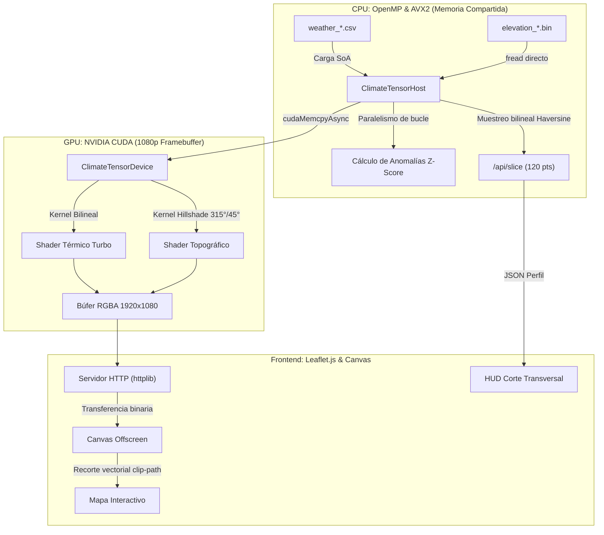

<div align="center">

# GeoThermal HPC Engine

[](https://isocpp.org/)
[](https://developer.nvidia.com/cuda-toolkit)
[](https://www.openmp.org/)
[](https://cmake.org/)
[](https://leafletjs.com/)
[](LICENSE)

**Motor híbrido de análisis meteorológico y microclimático en memoria compartida (OpenMP/AVX2) con renderizado continuo a 1080p y sombreado topográfico acelerado en hardware (NVIDIA CUDA).**

[Características](#características) • [Arquitectura](#arquitectura-de-procesamiento-híbrido) • [Estructura](#estructura-del-repositorio) • [Requisitos](#requisitos-del-sistema-y-dependencias) • [Puesta en Marcha](#puesta-en-marcha-rápida-quickstart) • [Datasets](#obtención-de-datos)

</div>

---

## Características

* **Cómputo Analítico Multihilo (OpenMP):** Detección estadística de anomalías térmicas ($Z\text{-Score}$) y cálculo de medias móviles sobre series temporales deslizantes sin secciones críticas bloqueantes.
* **Vectorización AVX2:** Estructura de Arreglos (SoA) alineada a 32/64 bytes para evitar penalizaciones de alineamiento de memoria en registros SIMD de CPU.
* **Renderizado Continuo en GPU (NVIDIA CUDA):** Framebuffer a resolución 1080p ($1920 \times 1080$) generado mediante interpolación bilineal de alta velocidad.
* **Sombreado Topográfico (*Hillshade*):** Cálculo de derivadas espaciales de terreno ($\frac{\partial z}{\partial x}, \frac{\partial z}{\partial y}$) e iluminación difusa oblicua (315° azimut, 45° altitud solar) con paleta hipsométrica continua.
* **Corte Transversal Dinámico (*Cross-Section*):** Muestreo geodésico con distancia Haversine a lo largo de un vector $A \rightarrow B$, sincronizando el perfil de relieve y temperatura con un cursor bidireccional en el mapa.
* **Frontend Web Interactivo:** Servidor HTTP REST embebido de baja latencia con interfaz basada en Leaflet.js, cinemática de partículas de viento, canvas offscreen y máscaras vectoriales costeras (GeoJSON).

---

## Arquitectura de Procesamiento Híbrido



---

## Estructura del Repositorio

* `include/` y `src/`: Backend en C++17, kernels CUDA (`.cu`), gestión de memoria Host/Device y servidor REST embebido.
* `web/`: Frontend interactivo (HTML5 Canvas, Leaflet, capas vectoriales GeoJSON y estilos en modo oscuro).
* `scripts/`: Herramientas auxiliares de generación sintética, conversión GeoTIFF a binario y procesamiento NetCDF.
* `data/elevations/`: Matrices topográficas estáticas binarias ($100 \times 100$ floats IEEE 754, 40 KB c/u).
* `config.json`: Catálogo regional, coordenadas geográficas (*Bounding Boxes*) y parámetros espaciales.

---

## Requisitos del Sistema y Dependencias

### 1. Hardware Mínimo Recomendado
* **CPU:** Procesador x86_64 multinúcleo (mínimo 4 núcleos físicos) con soporte para instrucciones **AVX2**.
* **GPU:** Tarjeta gráfica **NVIDIA** con arquitectura Maxwell o superior (Compute Capability >= 5.0).
* **RAM:** 8 GB de memoria de sistema disponible.
* **VRAM:** 2 GB de memoria de video dedicada.

---

### 2. Cadena de Compilación (C++ y CUDA)
* **Compilador C++:**
  * Windows: **Microsoft Visual C++ (MSVC)** v143 o superior (Visual Studio 2022 con *Desarrollo para el escritorio con C++*).
  * Linux: **GCC** 11+ o **Clang** 14+.
* **NVIDIA CUDA Toolkit:** Versión **12.0 o superior** (compilador `nvcc` y runtime).
* **CMake:** Versión **3.20 o superior**.
* **OpenMP:** Habilitado de forma nativa en MSVC (`/openmp`) y GCC/Clang (`-fopenmp`).

> **Dependencias de C++ embebidas:** `httplib.h` y `nlohmann/json` vienen incluidas de forma independiente (*header-only*) en el directorio `include/`.

---

### 3. Entorno de Python
Python 3.9+ (64-bit). Para instalar todas las librerías auxiliares:
```bash
pip install -r requirements.txt
```

---

## Puesta en Marcha Rápida (Quickstart)

### 1. Clonar el repositorio
```bash
git clone [https://github.com/TU_USUARIO/geothermal-parallel.git](https://github.com/TU_USUARIO/geothermal-parallel.git)
cd geothermal-parallel
```

### 2. Generar el dataset de prueba (Mock Data)
Genera la serie temporal horaria de 30 días y valida las mallas de relieve locales:
```bash
pip install -r requirements.txt
python scripts/generate_sample_data.py
```

### 3. Compilar el motor HPC con CMake
```powershell
cmake -B build -S .
cmake --build build --config Release
```

### 4. Ejecutar el Servidor
```powershell
.\build\Release\GeoThermalParallel.exe
```

Abre tu navegador en `http://localhost:8080` y explora los modos:
* **Temperatura:** Capa térmica continua interpolada por GPU a 1080p.
* **Anomalías:** Eventos térmicos clasificados por severidad de desviación típica ($Z\text{-Score}$).
* **Topografía:** Sombreado de laderas oblicuo y rampa hipsométrica.
* **Corte Transversal:** Haz clic en la herramienta, marca dos puntos sobre el mapa ($A \rightarrow B$) y observa el perfil topográfico y térmico con cursor sincronizado en tiempo real.

---

## Obtención de Datos

### 1. Datasets Meteorológicos Reales (Copernicus ERA5)
Para procesar reanálisis horarios reales de Copernicus Climate Data Store (CDS):
1. Descarga el archivo NetCDF (`.nc`) correspondiente a la región deseada en `data/datasets_copernicus/`.
2. Ejecuta el pipeline de interpolación hacia la cuadrícula del motor:
   ```bash
   python scripts/process_local_nc.py
   ```
   El script generará el archivo estructurado `data/weather_<region_id>.csv`.

### 2. Matrices Topográficas de Elevación (DEM GeoTIFF)
Para generar nuevos archivos de relieve binario (`.bin` de 40 KB) a partir de modelos digitales de elevación (Copernicus DEM GLO-90 o SRTM):
1. Coloca el ráster satelital en `data/elevations/dem_<region_id>.tif`.
2. Convierte el ráster a la cuadrícula fija de 100×100 floats:
   ```bash
   python scripts/process_elevation_raster.py
   ```
   El binario optimizado resultante se escribirá en `data/elevations/elevation_<region_id>.bin`.