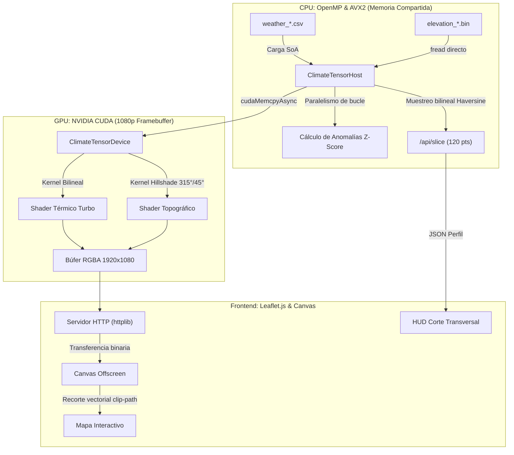

<div align="center">

# GeoThermal HPC Engine

[](https://isocpp.org/)
[](https://developer.nvidia.com/cuda-toolkit)
[](https://www.openmp.org/)
[](https://cmake.org/)
[](https://leafletjs.com/)
[](LICENSE)

Plataforma de cómputo heterogéneo y análisis espaciotemporal diseñada para procesar series temporales meteorológicas y volcánicas masivas. Combina paralelismo multinúcleo en CPU mediante OpenMP y vectorización AVX2 para detección estadística de anomalías ($Z\text{-score}$), aceleración por hardware en GPU con NVIDIA CUDA para renderizado continuo a 1080p con sombreado topográfico oblicuo (Hillshade), y un frontend interactivo en Leaflet.js con muestreo geodésico de corte transversal en tiempo real.

[Características](#características) • [Arquitectura](#arquitectura) • [Estructura](#estructura) • [Requisitos](#requisitos) • [Prototipo](#generación-de-un-prototipo) • [Datasets](#datasets)

</div>

---

## Características

* **Paralelismo en Memoria Compartida (OpenMP):** Normalización estadística ($Z\text{-Score}$) y cálculo de medias móviles sobre series temporales deslizantes.
* **Vectorización SIMD (AVX2):** Tensores en formato *Structure of Arrays* (SoA) alineados a 32 bytes para ejecución sin penalización en registros vectoriales de 256 bits.
* **Reducción Sin Bloqueos (*Critical-Free*):** Recolección concurrente de eventos anómalos mediante acumuladores privados por hilo, evitando la serialización de `#pragma omp critical`.
* **Renderizado Continuo en GPU (CUDA):** Mapeo de mallas discretas a texturas continuas de $1920 \times 1080$ píxeles a más de 60 FPS mediante interpolación bilineal espacial.
* **Sombreado Topográfico (*Hillshade*):** Cálculo en VRAM de derivadas espaciales ($\frac{\partial z}{\partial x}, \frac{\partial z}{\partial y}$) e iluminación solar oblicua (315° azimut, 45° altitud) con paleta hipsométrica.
* **Corte Transversal Dinámico (*Cross-Section*):** Muestreo geodésico offline vía fórmula de Haversine entre dos puntos arbitrarios ($A \rightarrow B$) con latencia sub-milisegundo y cursor bidireccional sincronizado con el mapa.
* **Transferencia de Baja Latencia:** Servidor HTTP C++ embebido con transmisión binaria directa (`application/octet-stream`) hacia canvas HTML5, eliminando la sobrecarga de compresión de imágenes.

---

## Arquitectura



---

## Estructura

```text
geothermal-parallel/
├── CMakeLists.txt                  # Configuración de compilación C++17, OpenMP y CUDA
├── config.json                     # Catálogo de regiones, Bounding Boxes y resoluciones
├── LICENSE                         # Licencia MIT
├── requirements.txt                # Dependencias de Python para soporte y adquisición
├── include/
│   ├── types.hpp                   # Estructuras SoA, píxeles RGBA y constantes del motor
│   ├── cpu_engine.hpp              # API del motor analítico OpenMP / AVX2
│   ├── cuda_engine.cuh             # Declaración de kernels de GPU y memoria de dispositivo
│   └── httplib.h / json.hpp        # Librerías embebidas header-only
├── src/
│   ├── main.cpp                    # Servidor HTTP REST, ruteo y telemetría de memoria
│   ├── cpu_engine.cpp              # Implementación de carga SoA y reducción estadística
│   └── cuda_engine.cu              # Kernels de interpolación 1080p y sombreado de relieve
├── scripts/
│   ├── generate_sample_data.py     # Generador rápido de datos sintéticos (Quickstart)
│   ├── process_local_nc.py         # Pipeline de conversión NetCDF (Copernicus) a CSV
│   └── process_elevation_raster.py # Conversor GeoTIFF DEM a matrices binarias .bin
├── web/
│   ├── index.html                  # Interfaz de usuario y controles de telemetría
│   ├── app.js                      # Lógica cliente Leaflet, shaders offscreen y gráficas
│   ├── styles.css                  # Estilos en modo oscuro (#0f111a / #090d16)
│   └── land_mask.geojson           # Geometrías vectoriales para recorte costero
└── data/
    └── elevations/                 # Matrices de cota optimizadas (100x100 floats, 40 KB c/u)
```

---

## Requisitos

| Componente | Requisito Mínimo |
| :--- | :--- |
| **CPU** | x86_64 multinúcleo con soporte para instrucciones **AVX2** |
| **GPU** | NVIDIA con Compute Capability $\ge 5.0$ (Maxwell o superior) |
| **Compilador C++** | MSVC v143+ (Visual Studio 2022) o GCC 11+ / Clang 14+ |
| **CUDA Toolkit** | Versión 12.0 o superior (`nvcc` y runtime) |
| **Herramientas de Build** | CMake $\ge 3.20$ |
| **Python** | 3.9+ (requerido únicamente para scripts auxiliares) |

---

## Generación de un Prototipo

### 1. Clonar el repositorio
```bash
git clone [https://github.com/bytoledo/geoThermal-Parallel.git](https://github.com/bytoledo/geoThermal-Parallel.git)
cd geoThermal-Parallel
```

### 2. Generar el dataset de prueba sintético
Genera la serie temporal meteorológica de 30 días ($100 \times 100 \times 720$) y valida la matriz de relieve sin requerir descargas externas:
```bash
pip install -r requirements.txt
python scripts/generate_sample_data.py
```

### 3. Compilar el proyecto
```powershell
cmake -B build -S .
cmake --build build --config Release
```

### 4. Iniciar el motor
```powershell
.\build\Release\GeoThermalParallel.exe
```

Abre `http://localhost:8080` en tu navegador para interactuar con la plataforma:
* **Temperatura:** Capa térmica continua generada por GPU a resolución 1080p.
* **Anomalías:** Eventos críticos filtrados con OpenMP ($\vert{}Z\vert{} \ge 2.5\sigma$).
* **Relieve:** Sombreado topográfico evaluado por iluminación solar.
* **Corte Transversal:** Traza una línea entre dos puntos ($A \rightarrow B$) para inspeccionar la silueta orográfica y térmica en tiempo real.

---

## Datasets

### Copernicus ERA5 (Datos Meteorológicos Reales)
Para procesar reanálisis horarios reales de Copernicus Climate Data Store:
1. Coloca el archivo NetCDF (`.nc`) en `data/datasets_copernicus/`.
2. Ejecuta el pipeline de interpolación hacia la cuadrícula del motor:
   ```bash
   python scripts/process_local_nc.py
   ```
   El resultado estructurado se guardará en `data/weather_<region_id>.csv`.

### Modelos Digitales de Elevación (DEM GeoTIFF)
Para generar matrices de relieve binarias (`.bin` de 40 KB) a partir de fuentes satelitales (Copernicus DEM GLO-90 o SRTM):
1. Coloca el ráster satelital en `data/elevations/dem_<region_id>.tif`.
2. Ejecuta la conversión:
   ```bash
   python scripts/process_elevation_raster.py
   ```
   El binario optimizado se generará en `data/elevations/elevation_<region_id>.bin`.

---

## Licencia

Este proyecto está bajo la Licencia MIT. Consulta el archivo [LICENSE](LICENSE) para más detalles.
