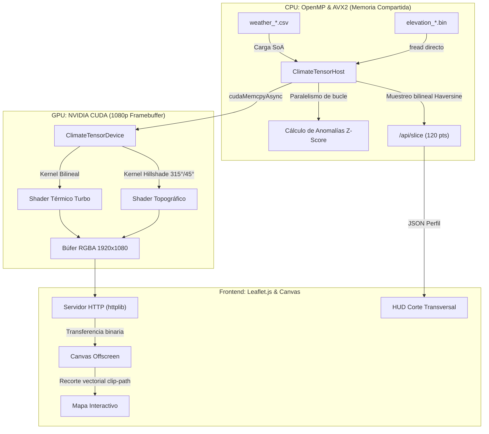

<div align="center">

# GeoThermal HPC Engine

[](https://isocpp.org/)
[](https://developer.nvidia.com/cuda-toolkit)
[](https://www.openmp.org/)
[](https://cmake.org/)
[](https://leafletjs.com/)
[](LICENSE)

**Motor híbrido de análisis meteorológico y microclimático en memoria compartida (OpenMP/AVX2) con renderizado continuo a 1080p y sombreado topográfico acelerado en hardware (NVIDIA CUDA).**

[Características](#características) • [Puesta en Marcha](#puesta-en-marcha-rápida) • [Arquitectura](#arquitectura-técnica) • [Datasets](#obtención-de-datos)

</div>

---

# GeoThermal HPC Engine

Pipeline analítico y de visualización espaciotemporal de microclimas con aceleración paralela híbrida:
* **CPU:** Procesamiento analítico en memoria compartida y detección de anomalías ($Z\text{-Score}$) mediante **OpenMP** y vectorización **AVX2**.
* **GPU:** Interpolación espacial continua a resolución 1080p y sombreado de relieve oblicuo (*Hillshade*) mediante **NVIDIA CUDA**.
* **Frontend Web:** Interfaz geográfica interactiva con **Leaflet.js**, telemetría en tiempo real, corte transversal topográfico y soporte de máscaras vectoriales.

---

## Arquitectura de Procesamiento Híbrido



---


## Estructura del Repositorio

* `include/` y `src/`: Backend de cálculo en C++17, kernels CUDA (`.cu`) y servidor HTTP REST.
* `web/`: Interfaz web (Leaflet, canvas dinámico, estilos y máscara costera GeoJSON).
* `scripts/`: Herramientas para generación sintética y procesamiento de rásteres satelitales / NetCDF.
* `data/elevations/`: Matrices topográficas binarias optimizadas (100×100 floats IEEE 754, 40 KB c/u).

---

## Requisitos del Sistema y Dependencias

### 1. Hardware Mínimo Recomendado
* **CPU:** Procesador x86_64 multinúcleo (mínimo 4 núcleos físicos) con soporte de instrucciones **AVX2**.
* **GPU:** Tarjeta gráfica **NVIDIA** con arquitectura Maxwell o superior (Compute Capability >= 5.0).
* **RAM:** 8 GB de memoria de sistema disponible.
* **VRAM:** 2 GB de memoria de video dedicada.

---

### 2. Cadena de Compilación (C++ y CUDA)
El backend combina C++17 con kernels de cómputo en CUDA y paralelismo en memoria compartida mediante OpenMP:

* **Compilador C++:** 
  * En Windows: **Microsoft Visual C++ (MSVC)** v143 o superior (incluido en Visual Studio 2022 con la carga de trabajo *"Desarrollo para el escritorio con C++"*).
  * En Linux: **GCC** 11+ o **Clang** 14+.
* **NVIDIA CUDA Toolkit:** Versión **12.0 o superior** (incluye el compilador `nvcc` y el runtime de CUDA).
* **CMake:** Versión **3.20 o superior**.
* **Soporte de OpenMP:** Integrado de forma nativa en MSVC (`/openmp`) y GCC/Clang (`-fopenmp`).

> **Librerías de C++ embebidas:** No es necesario instalar librerías externas mediante gestores de paquetes. Las dependencias `cpp-httplib` y `nlohmann/json` vienen incluidas como cabeceras independientes (*header-only*) dentro del directorio `include/`.

---

### 3. Entorno de Python (Herramientas y Scripts)
Python se utiliza para generar datos sintéticos inmediatos y procesar rásteres satelitales / NetCDF:

* **Versión:** Python **3.9 o superior** (64-bit).

#### Dependencias básicas (Modo Prototipo / Quickstart)
Para generar el dataset de prueba y correr el proyecto de inmediato:
```bash
pip install numpy
```

#### Dependencias completas (Procesamiento de datos satelitales y Copernicus)
Para ejecutar los pipelines de descarga y conversión (`process_local_nc.py`, `process_elevation_raster.py`, `get_land_mask.py`):
```bash
pip install numpy scipy xarray netCDF4 tifffile imagecodecs cdsapi requests
```

---

## Puesta en Marcha Rápida (Quickstart)

### 1. Clonar el repositorio
```bash
git clone [https://github.com/TU_USUARIO/geothermal-parallel.git](https://github.com/TU_USUARIO/geothermal-parallel.git)
cd geothermal-parallel
```

### 2. Instalar requerimientos de Python y generar datos
```bash
pip install -r requirements.txt
python scripts/generate_sample_data.py
```

### 3. Compilar el motor HPC con CMake
```powershell
cmake -B build -S .
cmake --build build --config Release
```

### 4. Ejecutar el Servidor
```powershell
.\build\Release\GeoThermalParallel.exe
```

Abre `http://localhost:8080` en cualquier navegador moderno y navega por las funciones:
* **Temperatura:** Capa continua interpolada por CUDA.
* **Anomalías:** Eventos críticos filtrados con OpenMP.
* **Topografía:** Sombreado de laderas por iluminación solar.
* **Corte Transversal:** Perfil geodésico de relieve en metros sobre el nivel del mar y temperatura en tiempo real.
